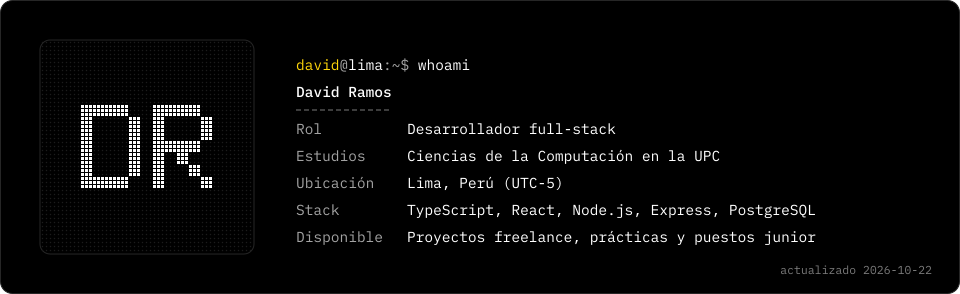

<!-- Generado por scripts/build.py a partir de templates/README.es.md y profile.yml. Edita esos archivos, no este. -->

[English](README.md) / **Español**

<picture><source media="(max-width: 600px)" srcset="assets/banner-es-mobile.svg"></picture>

### Desarrollador full-stack y estudiante de Ciencias de la Computación en la UPC (Lima, Perú)

Construyo productos web de punta a punta, desde la base de datos y la API hasta la interfaz, con TypeScript, React, Node.js y PostgreSQL.

Disponible para proyectos freelance, prácticas y puestos junior.

<a href="mailto:davidramosparihuaman.22@hotmail.com"><picture><source media="(prefers-color-scheme: dark)" srcset="assets/contact-email-es-dark.svg"><source media="(prefers-color-scheme: light)" srcset="assets/contact-email-es-light.svg"></picture></a>
<a href="https://www.linkedin.com/in/david-ramos-parihuaman-8a1115354"><picture><source media="(prefers-color-scheme: dark)" srcset="assets/contact-linkedin-es-dark.svg"><source media="(prefers-color-scheme: light)" srcset="assets/contact-linkedin-es-light.svg"></picture></a>

## Qué puedo aportar

| Área | Qué hago |
| --- | --- |
| Aplicaciones web full‑stack | Interfaces en React con TypeScript, APIs REST con Node y Express y bases de datos en PostgreSQL, desde el diseño hasta el despliegue. |
| Tiendas en línea y marketplaces | Catálogos, pedidos y paneles de administración para marcas pequeñas y vendedores independientes. |
| Despliegue y automatización | Docker, Azure, Linux y GitHub Actions. Este perfil se reconstruye solo cada día. |

## `$ whoami`

<picture><source media="(max-width: 600px)" srcset="assets/whoami-es-mobile.svg"></picture>

## Proyectos destacados

| Proyecto | Qué hace | Stack |
| --- | --- | --- |
| [ZAREGOKI](https://zaregoki.com) | Tienda en línea de una artista independiente: obra original y merch, con galería, carrito y pagos con Mercado Pago (tarjeta, Yape y Plin). Proyecto para una clienta; el código es privado. | TypeScript, React, Express, PostgreSQL |

## Stack

<picture><source media="(max-width: 600px) and (prefers-color-scheme: dark)" srcset="assets/stack-mobile-dark.svg"><source media="(max-width: 600px) and (prefers-color-scheme: light)" srcset="assets/stack-mobile-light.svg"><source media="(prefers-color-scheme: dark)" srcset="assets/stack-dark.svg"><source media="(prefers-color-scheme: light)" srcset="assets/stack-light.svg"></picture>

## Habilidades

<picture><source media="(prefers-color-scheme: dark)" srcset="assets/radar-focus-es-dark.svg"><source media="(prefers-color-scheme: light)" srcset="assets/radar-focus-es-light.svg"></picture>

Las áreas de enfoque son una autoevaluación.

## Modo arcade

Pac-Man y Bomberman recorren mi gráfico de contribuciones real, que se actualiza cada día.

<picture><source media="(prefers-color-scheme: dark)" srcset="https://raw.githubusercontent.com/DavidRamPari/DavidRamPari/output/pacman-contribution-graph-dark.svg"><source media="(prefers-color-scheme: light)" srcset="https://raw.githubusercontent.com/DavidRamPari/DavidRamPari/output/pacman-contribution-graph.svg"></picture>

<picture><source media="(prefers-color-scheme: dark)" srcset="https://raw.githubusercontent.com/DavidRamPari/DavidRamPari/output/bomberman-contribution-graph-dark.svg"><source media="(prefers-color-scheme: light)" srcset="https://raw.githubusercontent.com/DavidRamPari/DavidRamPari/output/bomberman-contribution-graph.svg"></picture>

Generado con mis propios scripts en Python (última ejecución: 2026-10-26). Idea visual inspirada en <a href="https://github.com/macu-dev">@macu-dev</a>.

