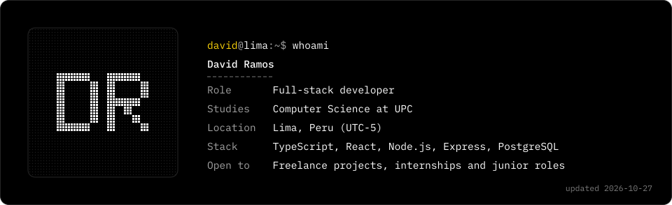

<!-- Generated by scripts/build.py from templates/README.en.md and profile.yml. Edit those files, not this one. -->

**English** / [Español](README.es.md)

<picture><source media="(max-width: 600px)" srcset="assets/banner-en-mobile.svg"></picture>

### Full-stack developer and Computer Science student at UPC in Lima, Peru

I build web products end to end, from the database and the API to the interface, with TypeScript, React, Node.js and PostgreSQL.

Open to freelance projects, internships and junior roles.

<a href="mailto:davidramosparihuaman.22@hotmail.com"><picture><source media="(prefers-color-scheme: dark)" srcset="assets/contact-email-en-dark.svg"><source media="(prefers-color-scheme: light)" srcset="assets/contact-email-en-light.svg"></picture></a>
<a href="https://www.linkedin.com/in/david-ramos-parihuaman-8a1115354"><picture><source media="(prefers-color-scheme: dark)" srcset="assets/contact-linkedin-en-dark.svg"><source media="(prefers-color-scheme: light)" srcset="assets/contact-linkedin-en-light.svg"></picture></a>

## What I can offer

| Area | What I do |
| --- | --- |
| Full‑stack web apps | React and TypeScript interfaces, REST APIs with Node and Express, and PostgreSQL data models, from design to deployment. |
| Online stores and marketplaces | Product catalogs, orders and admin panels for small brands and independent sellers. |
| Deploys and automation | Docker, Azure, Linux and GitHub Actions. This profile rebuilds itself every day. |

## `$ whoami`

<picture><source media="(max-width: 600px)" srcset="assets/whoami-en-mobile.svg"></picture>

## Featured work

| Project | What it does | Stack |
| --- | --- | --- |
| [ZAREGOKI](https://zaregoki.com) | Online store for an independent artist: original pieces and merch, with a gallery, a cart and payments through Mercado Pago (cards, Yape and Plin). Client project; the code is private. | TypeScript, React, Express, PostgreSQL |

## Tech stack

<picture><source media="(max-width: 600px) and (prefers-color-scheme: dark)" srcset="assets/stack-mobile-dark.svg"><source media="(max-width: 600px) and (prefers-color-scheme: light)" srcset="assets/stack-mobile-light.svg"><source media="(prefers-color-scheme: dark)" srcset="assets/stack-dark.svg"><source media="(prefers-color-scheme: light)" srcset="assets/stack-light.svg"></picture>

## Skills

<picture><source media="(prefers-color-scheme: dark)" srcset="assets/radar-focus-en-dark.svg"><source media="(prefers-color-scheme: light)" srcset="assets/radar-focus-en-light.svg"></picture>

Focus areas are self-assessed.

## Arcade mode

Pac-Man and Bomberman play through my real contribution graph, updated every day.

<picture><source media="(prefers-color-scheme: dark)" srcset="https://raw.githubusercontent.com/DavidRamPari/DavidRamPari/output/pacman-contribution-graph-dark.svg"><source media="(prefers-color-scheme: light)" srcset="https://raw.githubusercontent.com/DavidRamPari/DavidRamPari/output/pacman-contribution-graph.svg"></picture>

<picture><source media="(prefers-color-scheme: dark)" srcset="https://raw.githubusercontent.com/DavidRamPari/DavidRamPari/output/bomberman-contribution-graph-dark.svg"><source media="(prefers-color-scheme: light)" srcset="https://raw.githubusercontent.com/DavidRamPari/DavidRamPari/output/bomberman-contribution-graph.svg"></picture>

Generated by my own Python scripts (last run: 2026-10-15). Visual idea inspired by <a href="https://github.com/macu-dev">@macu-dev</a>.

